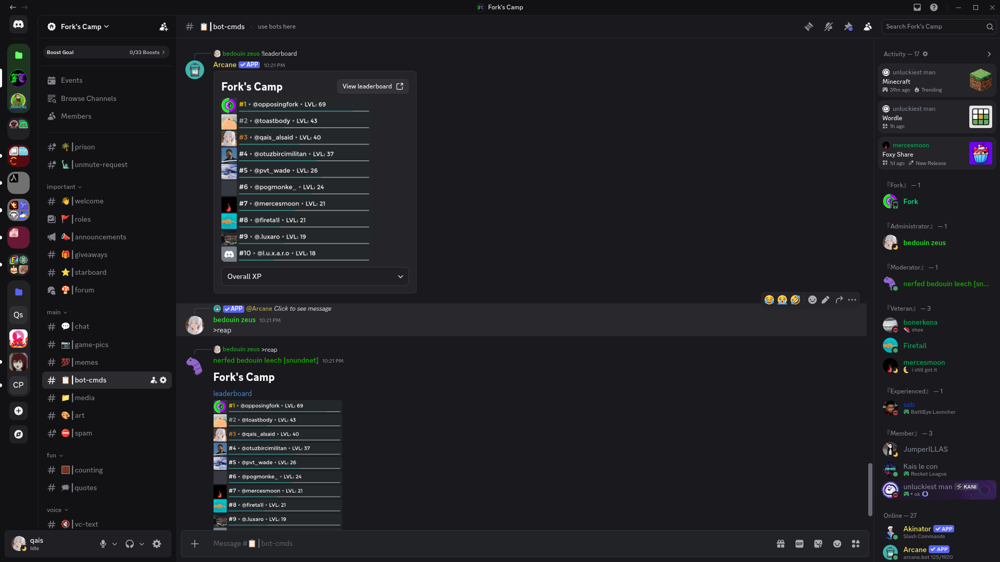

# Leech
A small Discord bot written in Python

It leeches onto other bots instead of implementing features itself: it can run their commands, press their buttons, and reap their output. It can also chat through LLMs.


> [!WARNING]
> Automating user accounts is against Discord's ToS. This project is strictly a proof of concept. And I do not recommend using it.



## Examples

```
you:   @leech what's on my todo list
leech: (runs >todo list on your behalf)
       here is your todo list: ...
```

```
you:        >cmd invoke type=slash bot=@fergun invocation="img google multi-images=false query=bird nice"
leech_nice: (runs fergun command and echos a text-based results buttons included)*
you:        (replying to leech_nice's message with button number) 2
leech_nice: (presses the button on your behalf)
```

```
you:          !level
Arcane:       (some embedded gibberish)
you:          (replying to Arcane's message) wtf is this i cant see it @framer_leech reap it for me
farmer_leech: (replies with the reaped embed, as readable text)
```

> the different names there to show that this is not one bot.
> each instance run under a user account you control.

## Templates

`cmd invoke template` saves **any** invocation as its own reusable command:

```
you:        >cmd invoke template command=bird-nice type=slash bot=@fergun invocation="img google query='bird nice'"
leech_nice: template bird-nice saved...

You:        >bird-nice
leech_nice: (runs it and echoes the result)
```

Any point after that the template acts like a real command: it shows up in the help, takes runtime arguments on top of its defaults, and persists across restarts.
The stored invocation could be partial, whatever you leave out gets filled at runtime, and whatever you've provided stays as default and can only be overwritten by `name=value`.

- `>cmd invoke template edit` can re-pin it to another channel or change the echo policy
- `>cmd invoke template remove` removes the template
- `>cmd invoke template list` lists all created templates

## Status
Leech is currently in early development `v0.1.x`

Current implemented features:

**core**
- command system with typed arguments (positional or named) and nested subcommands
- cog-based architecture with message listener hooks
- built-in help down to per-argument detail
- JSON-based persistence

**leeching**
- `>cmd invoke` - invoking other bot's commands (prefix or slash) on the fly 
- `>cmd invoke template` - persist any invocation as a new command
- `>cmd reap` - harvest **any** supported messages into normalized, text-first form while also maintaining usability
- `>cmd introspect` - browse the command surface of each bot (native, self, slash)
- `>cmd press` - press any button that is pressable by leech account
- echo policies - control what gets mirrored back and when: (text, media, files, buttons); (auto, always, never)

**AI**
- LLM chat - mentions, replies or `>ai talk`
- agentic mode - when a request maps to command, it runs it
- per-user delegations - allow or deny what the AI can run on your behalf
- configurable fallback model chain
- personas and context window, and dry-run mode

## Running

You will need git and python 3.14+

On Linux or Mac:

```bash
git clone https://codeberg.org/qais/leech.git
cd leech
python -m venv .venv
source .venv/bin/activate
pip install -e.
```

On Windows (cmd):
```bash
git clone https://codeberg.org/qais/leech.git
cd leech
python -m venv .venv
.venv\Scripts\activate
pip install -e.
```

On PowerShell use `.venv\Scripts\activate.ps1` instead.


Then for both OSs:

* create a file called `.env` and fill it using `example.env`
* run the bot:

```bash
python -m leech
```


## License
[MIT License](LICENSE)
