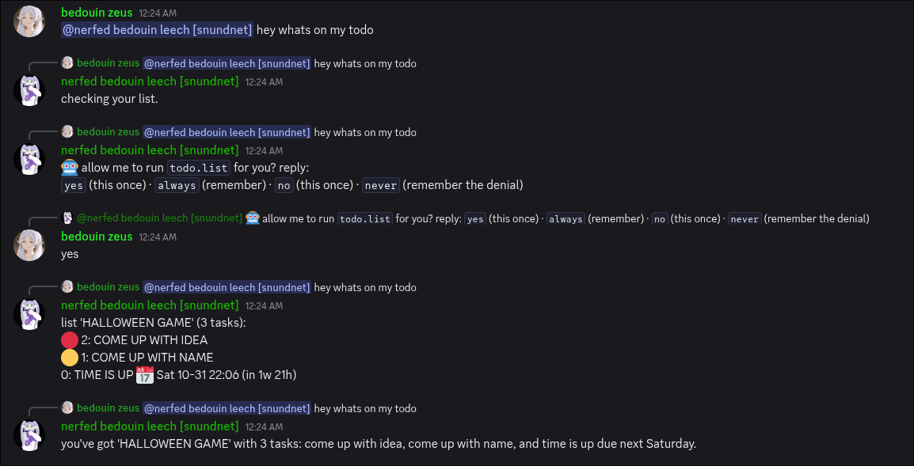
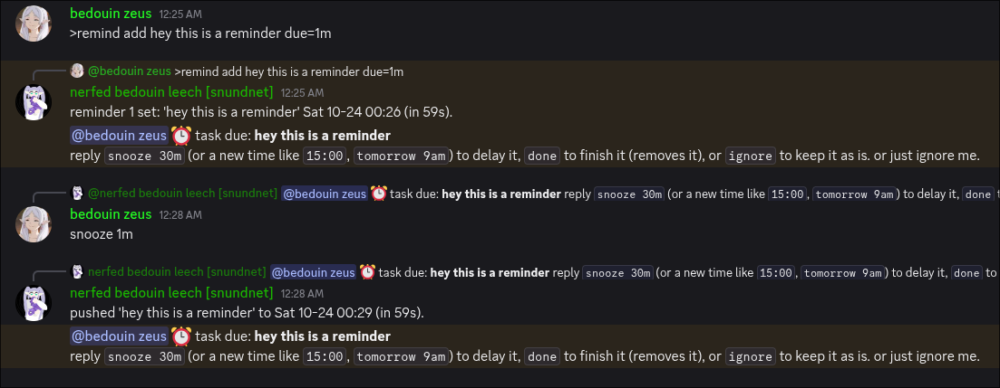
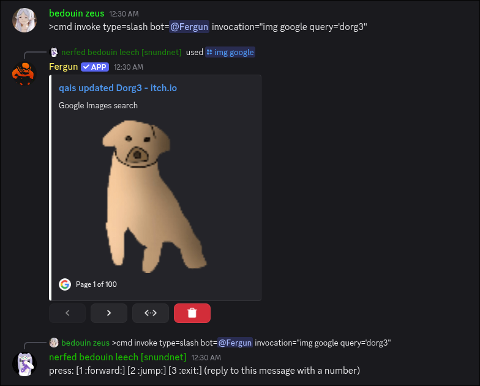
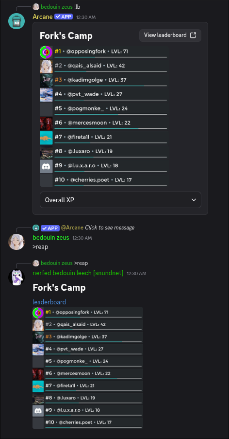

# Leech

<p align="center">

[](https://github.com/QaisAlsaid/leech/actions)
[](https://www.python.org/)
[](https://github.com/QaisAlsaid/leech/releases)
[](https://github.com/QaisAlsaid/leech/blob/master/LICENSE)
[](https://discord.gg/2y6r8MuaHy)

</p>

<p align="center">
  
</p>

A Discord bot written in Python. It used to be a parasite, it still is, but also implemented its own cool features.

It started as a leech: *riding* other bots, running their commands, pressing their buttons, reaping their output into readable text. It can still do all that. But now it also has its own feature set: todo lists with due dates and reminders, an AI assistant that can run commands for you, [TTS](https://github.com/KittenML/KittenTTS), [downloads](https://github.com/yt-dlp/yt-dlp), [lyrics](https://github.com/tranxuanthang/lrclib), [simple image tools](https://github.com/python-pillow/Pillow.git), and its own deployment pipeline.

> [!WARNING]
> Automating user accounts is against Discord's ToS. This project is strictly a proof of concept. And I do not recommend using it.

## What Leech is all about

**its own things**

- `>todo` - todo lists with editors and permissions, priorities (🔴 🟠 🟡), and hording lists, due dates with custom timezones and a reminder that pings with `done` / `snooze 30m` / `ignore`, undo, backups
- `>ai` - chat (mentions, replies, or direct `>ai talk`), agentic mode: when a request maps to a command it runs it, with per-user delegation rules (`allow` / `deny` / `ask`, default `ask` - it confirms with you in chat before running anything), personas per channel, a context window it actually remembers, and an audit log of everything it did
- `>tts` - voice clips and voice clones through the manager queue
- `>ytdlp` - downloads with lanes (colab / hub), default-lane pinning, queue cancel, cookies override support
- `>mono` - music search (flac track links work without the hub), `>lrc` - lyrics with synced/plain preference and zip mode
- `>png` - image compression
- long outputs are paginated with `next / prev / <number> / stop` replies instead of spam, and the pager footer never leaks into the AI's context

**leeching (origins)**

- `>cmd invoke` - invoke other bots' commands (prefix or slash) on the fly
- `>cmd invoke template` - persist any invocation as its own reusable command: it gets its own help entry, its own arguments, its own defaults; edit/list/remove like any other command
- `>cmd reap` - harvest any supported message into normalized, text-first form (embeds become readable text, media becomes links or files)
- `>cmd introspect` - browse the full command surface of each bot, paginated
- `>cmd press` - press any button pressable by the leech account, on harvested messages or live ones
- echo policies - what gets mirrored back and when: (text, media, files, buttons); (auto, always, never)

**deployment (self-hosting)**

- `>channel status / pull / revert` - the bot manages its own deploy: canary auto-deploy, probe-gated restarts, revert to last known good, pull a specific commit
- a supervisor sidecar (`deploy/supervisor.py`) watches the bot, pins versions, detects when it itself is stale, and surfaces the running semver (read from `pyproject.toml` when the clone has no tags)


## The three pieces

`leech` (this repo) is the bot and it runs fine on its own. The other two are optional (**highly recommended**: unlocks cool features):

- [**leech-server**](https://github.com/QaisAlsaid/leech-server) - an inference gateway: a manager plus GPU workers (it can operate from free colab/kaggle instances) serving TTS and AI to the bot over HTTP. Point `LEECH_TTS_URL` / `LEECH_AI_URL` at it and the bot will use it. leave them unset and the bot falls back to direct provider APIs (`GEMINI_API_KEY` / `GROQ_API_KEY`) or skips the feature.
- [**leech-hub**](https://github.com/SuperHackerHashidaItaru/leech-hub) - a heavy-job runner. Leech can offload long-running work (media processing, uploads) to it.

## Architecture

Every command goes through the same typed parser.

`>todo add wake up at 9am due="tomorrow"` is lexed, parsed into typed arguments, matched against the command registry, and dispatched.
Cogs are namespaces of handlers and services. The cog manager handles hot reloading without leaking resources.
Services persist through the store layer and never touch files directly.

## Repo layout

```
src/leech/
├── leech.py / main.py / config.py   # the bot account, entrypoint, env -> typed config
├── core/
│   ├── command/     # registry, binder, dispatcher, slash + native + self bindings
│   ├── parser/      # lexer + typed parser. every command goes through here
│   ├── store/       # base / json_store / supabase. one interface for two backends
│   ├── ai/          # service, schema, limits, audit
│   ├── security/    # grants + the delegation tri-state (allow, deny, ask)
│   ├── helpers/     # paginator, splitter, interactions, attachments
│   ├── cog/         # the cog manager, and cog context
│   └── provider/    # who issued what: self / native / slash / prefix
├── cogs/            # todo · ai · command · tts · ytdlp · mono · lrc · png ·
│                    # userphone · ffmpeg · channel · help · sudo · auth · ping
├── deploy/          # supervisor.py, control.py, supabase.sql
└── scripts/         # migrate_persistent.py, export_store.py, fix_list_order.py, release.py
tests/               # 126 and counting
```

at the root: `pyproject.toml`, `example.env` (every env var the bot actually reads, grouped and commented), `flake.nix` special for NixOS users.

## Running

You need git and python 3.14+.

```bash
git clone https://codeberg.org/qais/leech.git
cd leech
python -m venv .venv
source .venv/bin/activate   # windows: .venv\Scripts\activate or .venv\Scripts\activate.ps1
pip install -e .
cp example.env .env         # fill it using the comments
python -m leech # or run the supervisor via python deploy/supervisor.py
```

`example.env` documents every environment variable the bot reads, grouped and commented. Bot identity, the minimum is `BOT_ID` / `OWNER_ID` / `TOKEN`. Everything else is opt-in.


## Data

Everything persists through a small storage layer with two backends: plain json files (default, `persistent/v2/`) or supabase (`LEECH_STORE=supabase`). Every cog uses it. Writes are atomic on json and batched (0.5s flusher, outage queue) on supabase. a namespace that fails to load runs on defaults for the session and refuses to save rather than risk wiping live rows.

A few things **deliberately** stay local: tts voice clone files (and their catalog), yt-dlp `cookies.txt`, and the supervisor's own state (`persistent/v1/channel.json`).

## Known issues

- **a namespace that fails to load refuses to save** - **not a bug, it's a feature**. the never-wipe rule: a cog that booted on defaults can never overwrite live rows that session.
- **`semver: 3427138`** - a branch-only clone has no tags, so `git describe` degrades to a bare hash. the supervisor tries to pair it with the `pyproject.toml` version, a tagged master release makes it more pretty.
- **the pager is invisible to the AI** - navigation footer (`next / prev / stop`) never enters AI input, and that's pushed for later until we implement proper stdin/stdout pipelines.

## Screenshots

### AI asking for permissions to run command, then running it




### A Reminder firing




### Leech invoking other bots slash command




### A reaped embed, presented as readable text



## Status

early-ish development:

**canary** branch sits around `v0.8.x`. It moves, and occasionally breaks. 

**master** branch falls a bit behind canary but is generally a bit more stable. 

## Credits 

**[OpposingFork]()** although a bit annoying, but helped a lot in testing, and features, and shaping the bot.


**[mercesmoon](https://linktr.ee/mercesmoon)** helped with testing, and png tools shaping.


**[Gölge]()** helped with testing, actually the whole Auth system was created to ban him (joke).

> [!NOTE]
> This project was written using the help of [Z](https://z.ai]), and was audited by me.

## License
[MIT License](LICENSE)
